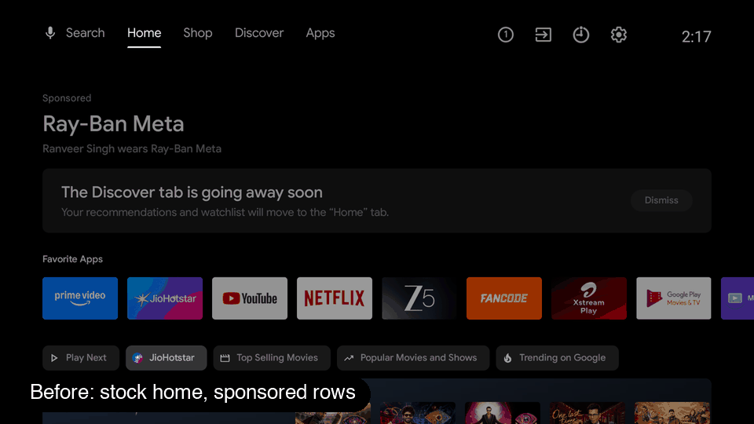
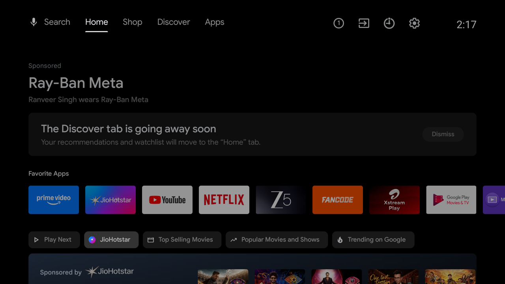
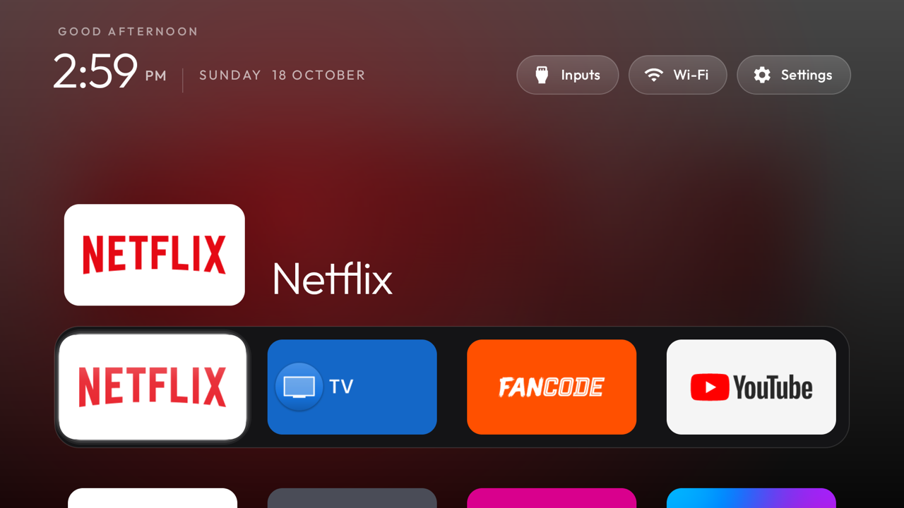
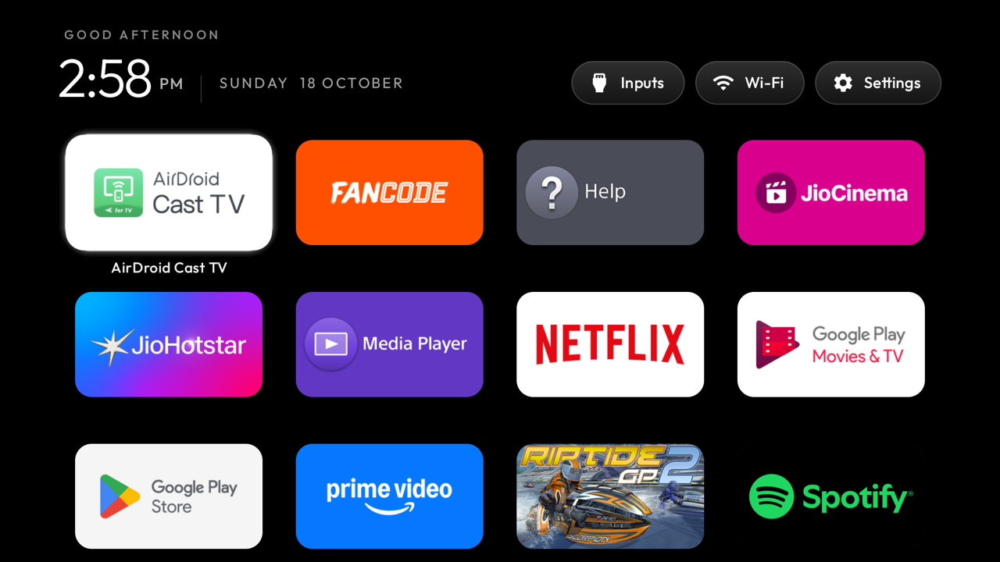
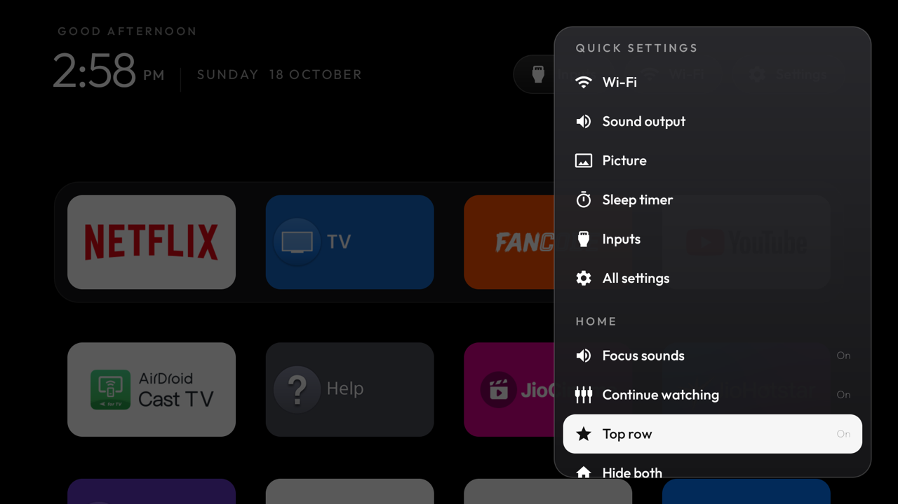

# TV de-ad kit

Remove the sponsored banners, ad rows and tracking apps from an Android TV / Google TV, and
(optionally) swap the home screen for a clean, Apple TV–style launcher. Everything runs over
Wi‑Fi ADB from your computer: no root, nothing uninstalled, and one command undoes it all.



| Before | After |
| --- | --- |
|  |  |

| All apps, most recently opened first | Quick settings: hide the shelves |
| --- | --- |
|  |  |

(Screenshots taken on a Sony Bravia VU2, Android TV 11.)

## Install in one line (no Claude needed)

macOS or Linux, with the TV on the same Wi-Fi:

```bash
curl -fsSL https://raw.githubusercontent.com/dhruv2003/sony-tv-launcher/main/install.sh | bash
```

It downloads the scripts to `~/tv-de-ad-kit`, sets up `adb` if you don't have it (Google's
platform-tools, into that folder, no admin rights), then starts a guided setup: it finds your TV, shows
you how to turn on debugging, lists exactly what it would disable and **waits for your yes**, and offers
the launcher. Nothing is uninstalled and `scripts/restore.sh` undoes it all. Run
`~/tv-de-ad-kit/scripts/setup.sh` any time to go through it again. Windows: use WSL.

**Launcher APK, ready to install (no building needed):**
[tv-home.apk](https://github.com/dhruv2003/sony-tv-launcher/releases/latest/download/tv-home.apk)
([all releases](https://github.com/dhruv2003/sony-tv-launcher/releases)). Install it with
`adb install tv-home.apk`, or let `scripts/install-launcher.sh` download and install it for you.

Tested on a Sony Bravia KD-55X80K (Google TV, Android 12) and a Sony Bravia VU2 (Android TV 11). It should work on any Android TV /
Google TV set (Sony, TCL, Hisense, Philips, Xiaomi, Chromecast with Google TV…); brand-specific
package lists live in `lists/`.

## Easiest: let Claude do it

1. Clone this repo and open [Claude Code](https://claude.com/claude-code) in it.
2. Say **"set up my TV"**.

Claude follows [`CLAUDE.md`](CLAUDE.md). It finds the TV, tells you which settings to flip with
the remote, shows you exactly what it wants to disable before touching anything, installs the
launcher if you want it, and checks the result with screenshots.

## Manual

(`scripts/setup.sh` runs these steps for you with questions in between.)

You need `adb` (`brew install --cask android-platform-tools` / `sudo apt install adb`), and
**Developer options → USB/ADB debugging** turned on on the TV (Settings → System → About →
press OK on *Android TV OS build* 7 times). No cable needed.

```bash
scripts/find-tv.sh                       # find the TV's IP
scripts/connect.sh 192.168.1.42          # approve the prompt on the TV
scripts/survey.sh                        # read-only list of what's on it
scripts/debloat.sh lists/google-tv-common.txt lists/sony-google-tv.txt   # asks before disabling
scripts/install-launcher.sh              # optional: the custom launcher
scripts/tv-home.sh custom                # make it Home (stock: scripts/tv-home.sh stock)
scripts/restore.sh                       # undo everything
```

Per-TV state (address, what was disabled) is kept in `state/`, which is git-ignored.

## The launcher

A dark (~60 KB) home screen with a "top shelf"
hero for the focused app, a Continue Watching row, a favourites dock with long-press reordering,
an all-apps grid, an Inputs menu, a quick-settings panel (Menu key) and subtle focus sounds.
No analytics and no ads. It only uses the network to load Continue Watching posters.
Source and build notes: [`launcher/`](launcher/README.md).

The UI is based on [tv-vibehack](https://github.com/Gathin23/tv-vibehack) by Gathin (MIT).

## Contributors

- [@dhruv2003](https://github.com/dhruv2003): the kit, scripts and launcher
- [@Beetroot16](https://github.com/Beetroot16) (Vishrut Deshmukh): one-line installer and guided setup, smooth blur on Android 11, top-row/Continue Watching switches, README screenshots ([#2](https://github.com/dhruv2003/sony-tv-launcher/pull/2))

## Contributing

Got it working on another brand? Add a `lists/<brand>-<platform>.txt` in the same commented
format and open a PR.

## License

MIT, see [LICENSE](LICENSE). Bundled: tv-vibehack (MIT) and the Outfit font (OFL 1.1), see
`launcher/LICENSE-tv-vibehack.txt` and `launcher/FONT-LICENSE-OFL.txt`.
